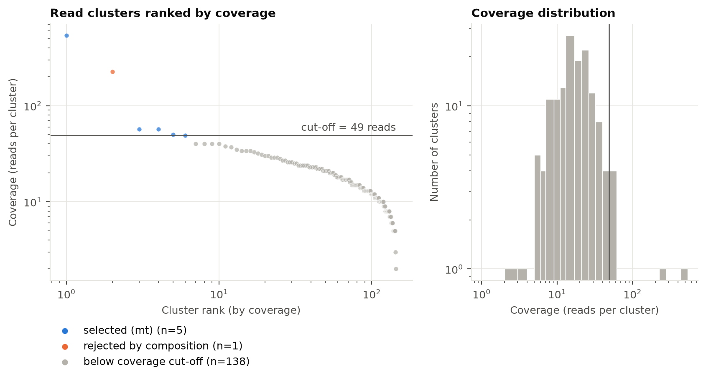
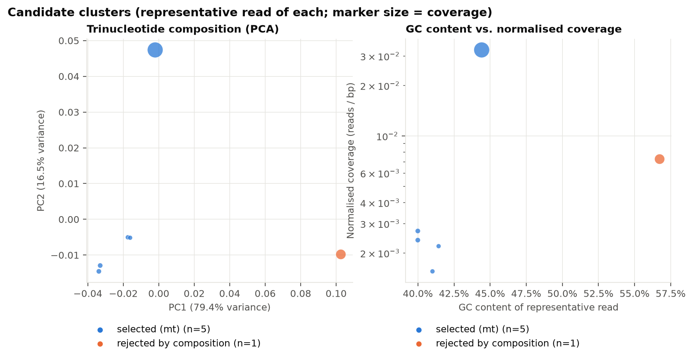
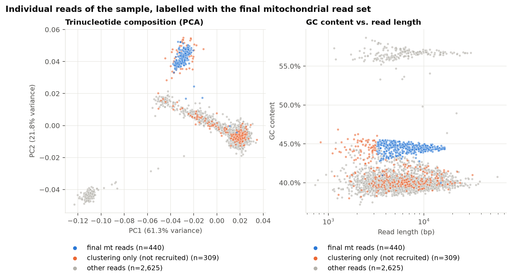
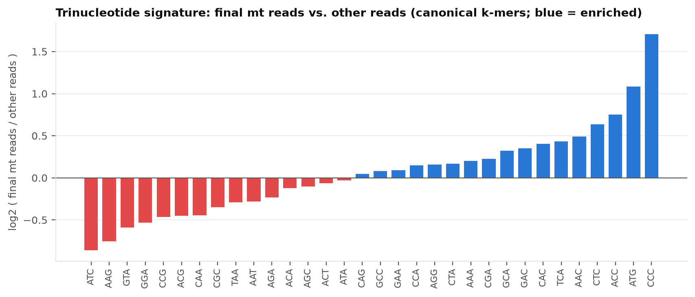
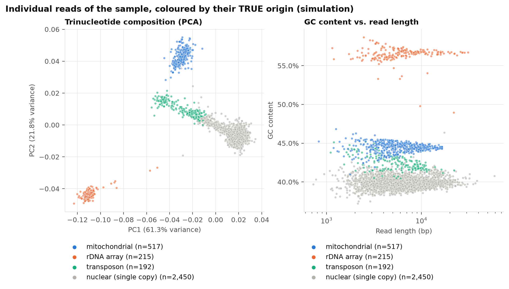
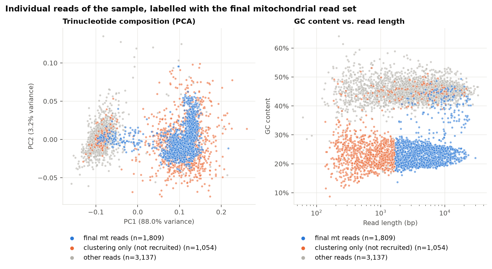

<p align="center"></p>

<h1 align="center">MITochondrial NANopore reads EXtractor</h1>

<div align="center">

  []()
  [](/LICENSE)

</div>

---

## Table of Contents
+ [About](#about)
+ [Installation](#installation)
+ [Usage](#usage)
+ [Outputs](#outputs)
+ [How does MITNANEX work?](#algorithm)
+ [Diagnostic plots](#plots)
+ [Project layout](#layout)
+ [Testing](#testing)
+ [Changes in v0.2](#changes)

## 🧐 About <a name="about"></a>

MITNANEX extracts mitochondrial Nanopore reads from **whole-genome sequencing**
data and assembles the mitogenome. It has two modes:

* **`denovo`** — no reference or seed needed: reads are clustered by overlaps, high-coverage
  clusters are kept, and the mitochondrial ones are told apart from nuclear repeats by their
  trinucleotide composition. The selected reads seed an assembly with miniasm and Flye.
* **`reference`** — reads are mapped to a reference mitogenome, NUMTs are removed through a
  Flye assembly, and variants (homo/heteroplasmies) are called with GATK Mutect2 in
  mitochondrial mode.

## 🏁 Installation <a name="installation"></a>

All dependencies (Python libraries and bioinformatics tools) are installed with **mamba**:

```bash
git clone https://github.com/juanjo255/MITNANEX.git
cd MITNANEX
mamba env create -f environment.yml
mamba activate mitnanex
pip install --no-deps -e .     # installs the `mitnanex` command
```

No Rust toolchain is needed any more (the k-mer counter is now NumPy).
On Apple Silicon a few bioconda tools are x86_64 builds and run through Rosetta 2.

## 🎈 Usage <a name="usage"></a>

```bash
mitnanex denovo    -i reads.fastq.gz -o results -t 8          # reference-free
mitnanex reference -i reads.fastq.gz -R chrM.fasta -o results  # with a reference
mitnanex extract   -i sample.fastq -a overlaps.paf -o results  # only the read selection
mitnanex <command> --help                                       # all options
```

The short options of the old shell scripts still work (`-i -t -p -m -M -r -c -x -d -s -q -f -k -K -S -y`).

### `denovo` main options

| Option | Default | Meaning |
|---|---|---|
| `-p, --proportion` | 0.4 | Reads used for the all-vs-all overlaps: fraction, or a number of reads (`50000`). The overlap step's memory grows quickly with this number: on an 8 GB laptop use **`-p 50000`** (≈ 4–5 GB). |
| `-m / -M` | – | Min / max read length (also the minimum overlap length). |
| `-s, --min-identity` | 0.6 | Minimum overlap identity (matches / alignment length) to put two reads in the same cluster. **Depends on read accuracy**: ~0.6 suits R10.4.1 (≈2% error); use ~0.35 for R9-era (≈5–6% error) reads. |
| `-c, --min-coverage` | auto | Minimum reads per cluster. Default: the largest gap in the sorted cluster coverages. |
| `-x, --min-clusters` | 3 | The automatic cut-off must keep more than this many clusters. |
| `--profile` | `members` | Composition of a cluster from all its reads pooled (`members`) or from its longest read only (`longest`, the v0.1 behaviour; see [Changes](#changes)). |
| `--group-rule` | `max` | Which composition group is mitochondrial: the one holding the highest-coverage cluster (`max`) or the one with the highest median coverage (`median`, the v0.1 rule; see [Changes](#changes)). |
| `-y, --haplotype` | off | One composition group per cluster (keeps only the best cluster). |
| `-k, --keep-percent` | 90 | Filtlong `--keep_percent` for recruited reads. |
| `-f, --flye-mode` | `--nano-hq` | Flye read type. |
| `--resume` | off | Skip steps whose outputs already exist. |

### `reference` main options

| Option | Default | Meaning |
|---|---|---|
| `-R, --reference` | required | Single-contig mitogenome FASTA (bundled rCRS: `mitnanex/data/refseqMT/chrMT.fna`). |
| `--mapq` | 30 | Minimum mapping quality. |
| `--min-length / --max-length` | 500 / reference length | Read length filter (chopper). |
| `--min-mean-quality` | 10 | Minimum mean read quality (chopper). `--no-filter` skips chopper. |
| `--min-pruning`, `--kmer-size` | 3, `15,25` | GATK Mutect2 assembly options. |
| `--annotate-rcrs` | off | Annotate variants with rCRS regions (hypervariable, homopolymers, hotspots, genes). |
| `--liftoff` | off | Lift genes from the reference GFF3 to the consensus (needs `liftoff`). |
| `--haplogrep PATH` | off | Classify haplogroups with a haplogrep3 binary. |
| `--mitomap` | off | **Uploads** PASS variants to the MITOMAP web service for annotation. |

## 📦 Outputs <a name="outputs"></a>

`denovo` (all files start with the prefix, default = input file name):

| File | Content |
|---|---|
| `*_mt_assembly.fasta` | Mitogenome contig chosen among Flye contigs (circular preferred, then coverage, then length). |
| `*_mt_reads.fastq` | Final mitochondrial reads (all reads mapping to the assembly, filtered by filtlong). |
| `*_putative_mt_reads.fasta` | Reads selected by the clustering step (input of miniasm). |
| `*_clusters.tsv` | Every read cluster: coverage, representative read, GC, PCA coordinates, K-means group and status. |
| `*_read_clusters.tsv` | Read → cluster assignment and whether the read was selected. |
| `*_first_draft_asm.{gfa,fasta,tsv}` | Miniasm unitigs (and a table with length, GC, reads, circularity). |
| `*_summary.json` | Key numbers of the run. |
| `plots/` | Diagnostic figures (see below). |
| `mitnanex.log`, `logs/tools.log` | Pipeline log (every command run) and the stderr of the external tools. |

`reference`: `MT_genome.fasta` (consensus), `*.mt_reads.fastq`, `*.sorted.bam`,
`VariantCall/gatk_mutect2/*.filt.vcf` (+ `.tsv`), `plots/*_variants_along_genome.png`,
`plots/*_variant_summary.png`.

## ⚙️ How does MITNANEX work? <a name="algorithm"></a>

1. **Subsample and sort** the reads (seqkit, seqtk) and find **all-vs-all overlaps** (minimap2 `ava-ont`).
2. **Filter overlaps** (pandas): identity ≥ `--min-identity`; drop *internal matches*
   (alignments that stop well before the read ends — shared repeats), using miniasm's
   classification (Li 2016, Algorithm 5).
3. **Greedy clustering**: overlaps are visited in order; a read pair opens a new cluster, or the
   unclustered read joins its partner's cluster. A cluster's *coverage* is its number of reads
   and it is represented by its longest read. Mitochondrial DNA has many copies per cell, so its
   reads form a few large clusters.
4. **Coverage filter**: clusters above the largest gap of the sorted coverages are kept.
5. **Composition filter**: each candidate cluster is described by the 32 canonical trinucleotide
   frequencies of all its reads pooled, reduced to 2-D with PCA and split by K-means (weighted by
   normalised coverage = reads / bp). The group with the highest-coverage cluster is kept.
6. **Assembly**: miniasm builds draft unitigs from the selected reads; these recruit reads from
   the *whole* dataset (minimap2), which are filtered (filtlong) and assembled with Flye
   (`--meta`, robust to uneven coverage); the mitogenome contig is selected (a contig made of two
   tandem copies of the mitogenome — a Flye circular dimer — is reduced to one copy) and used to
   recruit the final read set.

## 📊 Diagnostic plots <a name="plots"></a>

Each decision of the algorithm has a figure in `plots/`. Examples below come from a simulated
dataset (`tests/simulate.py`: the human mitogenome + a synthetic nuclear genome with an rDNA
array, transposons and a NUMT).

**1. Coverage filter** — clusters ranked by coverage, with the automatic cut-off:
<p align="center"></p>

**2. Candidate clusters** — trinucleotide PCA of the representative reads and GC vs.
normalised coverage. Here the GC-rich rDNA cluster is rejected and the large mitochondrial
cluster is kept:
<p align="center"></p>

**3. Individual reads** — every read of the sample in trinucleotide space, labelled with the final
mitochondrial read set (blue) vs. nuclear reads (gray). Orange reads were selected by the
clustering but not recruited by the final assembly:
<p align="center"></p>

**4. Trinucleotide signature** of the mitochondrial reads relative to the rest:
<p align="center"></p>

For simulated data, `tests/benchmark.py` redraws the read plot with the **true** origin of each read:
<p align="center"></p>

Other figures: read-length distributions, and for `reference` the depth / allele fraction along
the mitogenome, the substitution spectrum and the allele-fraction distribution.

## 🗂 Project layout <a name="layout"></a>

```
mitnanex/
├── cli.py              command line (denovo / reference / extract)
├── io.py               FASTQ/FASTA/PAF/GFA readers & writers
├── overlaps.py         overlap filtering (identity, internal matches)
├── clustering.py       greedy read clustering
├── kmers.py            canonical k-mer profiles (NumPy)
├── selection.py        coverage cut-off + PCA/K-means selection
├── extract.py          de novo read extraction (the old main.py)
├── assembly.py         miniasm GFA → FASTA, Flye contig selection
├── plots.py            diagnostic figures
├── vcf.py              VCF/depth parsing and variant figures
├── external.py         safe wrappers for external tools
├── pipelines/          denovo.py, reference.py (ports of the shell scripts)
└── data/refseqMT/      rCRS reference, annotation BED/GFF3
tests/                  unit tests, read simulator, benchmark
```

## 🧪 Testing <a name="testing"></a>

### Real datasets (MITNANEX v0.2, default options except `-p`)

| Species | Run | Reads (mean Q) | Contig | Reference | Ref. covered | Identity* | Time** |
|---|---|---|---|---|---|---|---|
| *Candida auris* | SRR25455202 | 143k (Q13.8) | 27,061 bp, circular, 886× | CP132762 (28,179 bp) | 100% | 99.83% | 11 min |
| *Ascochyta lentis* | SRR14075486 | 282k (Q12.6), `-p 50000` | 52,407 bp, circular, 97× | CP118466 (52,190 bp) | 100% | 99.83% | 10 min |
| *Aspergillus fumigatus* | ERR10820709 | 508k (Q10.2), `-p 50000` | 30,650 bp, circular, 1,315× | NC_017016.1 (30,696 bp) | 99.99% | 99.77% | 21 min |

\* Gap-compressed identity (an indel counts once). Remaining differences are mostly short
homopolymer indels (expected without polishing) and, for *C. auris*, one 1.1 kb strain-specific indel.
\*\* Apple Silicon Mac (8 cores), 8 GB RAM, 8 threads.

Reads recruited before filtlong contained 99.9–100% of the reads that map to the published
mitogenome. Filtlong then keeps 90% of the *bases* (favouring long reads), i.e. ≈ 84–90% of the
mitochondrial bases but only ≈ 51–56% of the reads.

To reproduce the validation (needs the published mitogenome):

```bash
python tests/validate_assembly.py --run-dir results/ --prefix SRR25455202 \
    --reference CP132762.fasta --reads SRR25455202.fastq
```

Mitochondrial reads of *C. auris* (blue, ~23% GC) against nuclear reads (gray, ~45% GC):
<p align="center"></p>

### Simulated data and unit tests

```bash
pytest tests/                                                    # unit tests
python tests/simulate.py --out sim.fastq --mito-depth 600        # simulated WGS dataset
mitnanex denovo -i sim.fastq -o sim_results -t 8
python tests/benchmark.py --run-dir sim_results --prefix sim --reads sim.fastq
```

On the simulated dataset (mtDNA ≈ 50 copies per nuclear genome, 2% read error) the pipeline
recovers the circular mitogenome at 100% identity to rCRS.

**Known limitation.** Selection relies on mitochondrial DNA being the highest-depth material.
If a nuclear tandem repeat (typically the rDNA array) has a higher per-base depth than the
mitogenome, its cluster is selected instead. Always check `plots/*_2_candidate_composition.png`
and the length/circularity of the final contig.

**Variant calling with long reads.** GATK Mutect2 is designed for short reads: with Nanopore
reads it counts only a fraction of the reads as informative (e.g. 3 of 15 at a site), and at low
depth single reads with sequencing errors can produce PASS calls with low allele fraction.
Interpret low-AF calls with care, ideally with high depth. On Apple Silicon, GATK's accelerated
PairHMM (Intel GKL) is unavailable, so Mutect2 is very slow with long reads.

## 📝 Changes in v0.2 <a name="changes"></a>

The tool was rewritten as an installable Python package (`mitnanex`), replacing the shell scripts,
`main.py`, `src/` and the Rust extension. Behaviour changes and fixes:

* **Mitochondrial group choice** (`--group-rule max`, new default). v0.1 kept the K-means group
  with the highest *median* coverage. When K-means isolates a GC-distinct nuclear repeat (e.g.
  rDNA) and groups the mitochondrial cluster with low-coverage nuclear clusters, those clusters
  outvote it and the rDNA is assembled instead. The old rule is available with `--group-rule median`.
* **Cluster composition from all member reads** (`--profile members`, new default). v0.1 used each
  cluster's longest read. In real data that read is often a chimeric/NUMT read longer than the
  mitogenome (e.g. a 47 kb read with 44% GC representing an *A. fumigatus* mitochondrial cluster
  whose reads have 27% GC), so mitochondrial clusters were misplaced or rejected.
* **Circular dimers collapsed**: Flye assembled the *A. lentis* mitogenome as two tandem copies
  (104,780 bp); the selected contig is now reduced to one copy.
* `-c/--min-coverage` was parsed but ignored; it now sets the coverage cut-off.
* The automatic coverage cut-off crashed (`None`) when there were too few clusters; it now keeps all.
* Flye contig selection took the *first line* of `assembly_info.txt` instead of the best contig
  when no contig was circular.
* The k-mer counter crashed on reads with `N`; such k-mers are now skipped.
* `--annotate-rcrs`: the bundled BED files used `chrM` while the reference/VCF use `NC_012920.1`,
  and bcftools needs bgzipped + tabix-indexed annotations — both handled now.
* GATK index/dictionary are created for any reference (previously only the bundled one worked).
* Errors in the middle of a pipe (`minimap2 | samtools`) now stop the pipeline; every log line has
  its real timestamp (previously all lines showed the start time).
* `fpa` (no arm64 build) and `gfastats` were replaced by pandas code; `vcfstats` by matplotlib figures.
